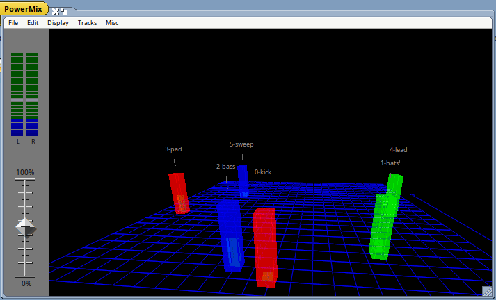
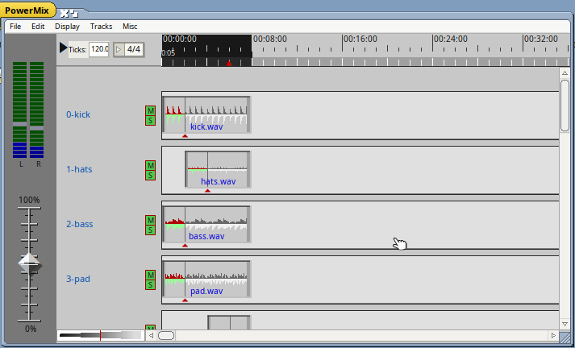
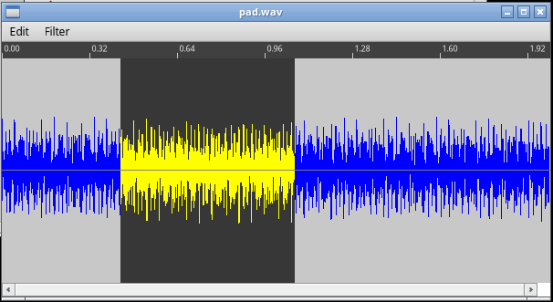
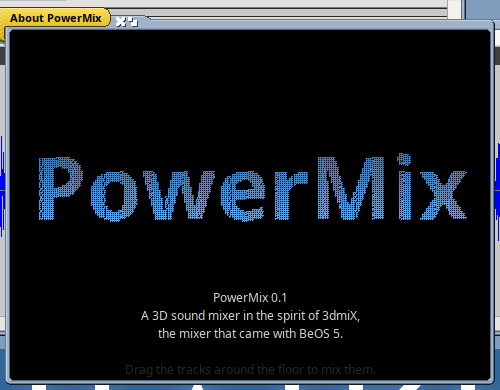
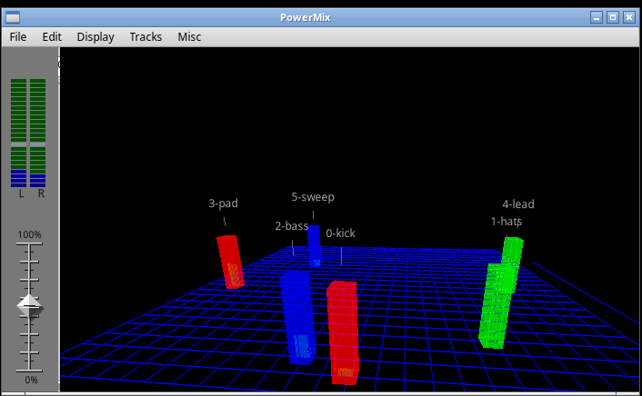

# PowerMix

A 3D sound mixer for Haiku and Linux in the spirit of **3dmiX**, the mixer
that came with BeOS 5. Each track of a mix stands as a translucent column
on a floor in front of the listener: drag it left or right to pan it,
nearer or farther to make it louder or quieter. The columns pulse with the
music.

PowerMix is a new program, written from a study of the original: it was
run on BeOS 5 in a virtual machine, and its behaviour, file formats and
drawing were read from its code. It contains none of Be's code, images,
sounds or text (beyond menu labels). It opens 3dmiX's `.3dmix` projects,
including the sample mixes that came with BeOS 5.

## What it does

- **The 3D mixer** (Display ▸ Show/hide mixer): drag tracks around the
  floor, drag empty space to turn the view (flick it and it keeps
  spinning), Shift-drag to move in depth only. Keys while it shows: arrows
  move the selection, + and − zoom, A selects all, M mutes, S solos, D
  turns the view slowly, P throws particles from the loudest tracks, W
  goes back to the tracks. Muted tracks sink.
- **The mix** is 3dmiX's: gain from depth, a sine/cosine pan and the delay
  between the ears from the place on the floor. Against the original's
  own "Save mix as WAVE", half of the mixing blocks match sample for
  sample and the rest differ by a frame at some block boundaries.
- **Tracks** hold clips that loop part of a sound. Drag a clip to move it,
  its ends to trim it, the red handle below it to set its loop; Ctrl snaps
  to the beat, Shift-resizing resamples the sound to fit and Option-resizing
  stretches it. Clips never overlap: later ones are pushed back. Cut, copy,
  paste, clear and one level of undo.
- **Sounds** come in by dragging files onto a lane (a clip there) or
  anywhere else (a new track). WAVE files (PCM, and MS ADPCM as the BeOS
  sample sounds use) are read by PowerMix itself; other formats go through
  the Media Kit.
- **The sound editor** (double-click a clip): select, cut, copy, paste, and
  the filters Zero, Change volume, Max volume, Echo, Chorus, Metal, Fade and
  Compress, done as 3dmiX did them.

  
- **The time ruler** sets the part that loops (and is saved by File ▸ Save
  mix as WAVE); Ticks and the 3/4…7/4 menu set the beat grid, and Misc ▸
  Ticks from… works it out from the selection or a clip.
- **About PowerMix** forms the name from a swirl of dots while a chord
  swells, as 3dmiX's About box did.

  

## What's different from 3dmiX

On purpose:

- Haiku's conventions: menu items in sentence case with "…", Quit has a
  shortcut (Alt-Q, Ctrl-Q on Linux), the window is titled PowerMix.
- Links to projects are followed (3dmiX opened the BeOS samples' links as
  empty projects).
- A saved mix is a correct WAVE file (3dmiX's header overwrote its first
  11 frames).
- Without an audio output the mix still runs, silently (3dmiX stopped).
- Sounds at other sample rates are resampled to 44.1 kHz (3dmiX assumed
  44.1 kHz); stereo sounds become mono, as in 3dmiX.
- The About window and its sound are PowerMix's own, made the same way.

Not (yet) like the original:

- Colours in the 3D view are chosen from BeOS's palette by Haiku's rule;
  BeOS 5's own table differs for about 4% of colours.
- The time ruler's tick spacing follows the original's look, not its code.
- On Linux the Ticks box's controls are a little cramped.

## Platforms

| Platform | Package | Tested |
|---|---|---|
| Haiku R1/beta6, Renku (x86_64) | `.hpkg` (not yet released) | built and run in a VM: 3D view, tracks, editing, import, editor, About, script checks; no audio device in the VM, so playback was silent |
| Linux (x86_64) | AppImage through [Hokku](https://github.com/idumych/hokku) (not yet released) | built locally and run under Xvfb (X11): tracks, 3D view, editor, script checks |

## Building

Haiku: `make` (needs the Media Kit, which Haiku has). Linux with Hokku:
`make COSMOE_ROOT=/usr`. Host tests on any system: `make test` (more of
them run when a copy of the BeOS 5 sample mixes is in
`vm/orig/boot/optional/sound/3D Mixes`).

`tests/fixtures/demo/` is a small demo project made by
`tools/host/make_demo.cpp`. `PowerMix --do 'open FILE; dump; export
OUT.wav; drop SOUND LANE TIME; quit'` drives the app from scripts.

`NOTES.md` records what was learned about 3dmiX and how; the tools used to
study it (a BeOS 5 VM, Ghidra scripts) are in `tools/`.

## Licence

MIT. 3dmiX was made by Be, Inc.; PowerMix is not affiliated with Be or
its successors.
